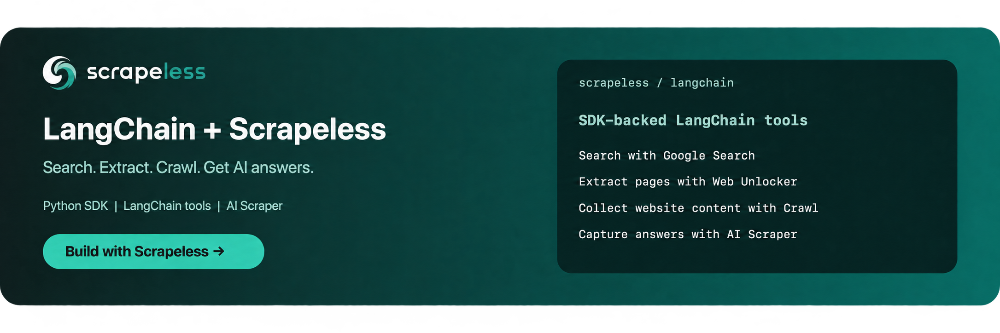

<p align="center">
  <a href="https://app.scrapeless.com/passport/login?redirect=%2Fquick-start&amp;utm_source=github&amp;utm_medium=referral&amp;utm_campaign=langchain-scrapeless&amp;utm_content=repository-readme"></a>
</p>

# Use Scrapeless in LangChain

<p align="left">
  <a href="https://app.scrapeless.com/passport/login?redirect=%2Fquick-start&amp;utm_source=github&amp;utm_medium=referral&amp;utm_campaign=langchain-scrapeless&amp;utm_content=repository-readme"></a>
  <a href="https://www.scrapeless.com/en/blog?utm_source=github&amp;utm_medium=referral&amp;utm_campaign=langchain-scrapeless&amp;utm_content=repository-readme"></a>
  <a href="https://x.com/Scrapelessteam?utm_source=github&amp;utm_medium=referral&amp;utm_campaign=langchain-scrapeless&amp;utm_content=repository-readme"></a>
  <a href="https://www.linkedin.com/company/scrapeless/?utm_source=github&amp;utm_medium=referral&amp;utm_campaign=langchain-scrapeless&amp;utm_content=repository-readme"></a>
</p>

Use Scrapeless tools in LangChain workflows to search Google, extract pages with Web Unlocker, collect website content with Crawl, and capture AI-generated answers with AI Scraper through the Python SDK.

**[Get your Scrapeless API key with $5 Free credits!](https://app.scrapeless.com/passport/login?redirect=%2Fquick-start&utm_source=github&utm_medium=referral&utm_campaign=langchain-scrapeless&utm_content=repository-readme)**

- **Documentation:** [Scrapeless LangChain integration page](https://docs.scrapeless.com/en/integrations/langchain/?utm_source=github&utm_medium=referral&utm_campaign=langchain-scrapeless&utm_content=repository-readme)

**langchain-scrapeless** is designed for seamless integration with LangChain, enabling you to:

- Retrieve structured Google Search results.
- Extract webpage content with Web Unlocker.
- Collect individual pages, batches of pages, or linked website pages with Crawl.
- Collect AI-generated answers and available source data from supported AI Scraper engines.
- Compose these tools into LangChain workflows and agents.

## 📦 Installation

Use Python 3.10 or later. Until the matching PyPI update is published, install the reviewed source from the directory containing `pyproject.toml`:

```bash
python -m pip install .
```

After the matching package release is available, install it from PyPI:

```bash
python -m pip install -U langchain-scrapeless
```

The existing `0.1.3` release does not include the AI Scraper tools below.
For the optional LangChain 1.x agent examples, also install:

```bash
python -m pip install "langchain>=1,<2" "langchain-openai>=1,<2"
```

## ✅ Prerequisites

You should configure the credentials for the Scrapeless API in your environment variables.

- `SCRAPELESS_API_KEY`: Your Scrapeless API key.
- `OPENAI_API_KEY`: Required only for the optional `ChatOpenAI` agent examples.

On macOS or Linux, set the required key before running a tool:

```bash
export SCRAPELESS_API_KEY="YOUR_SCRAPELESS_API_KEY"
```

In PowerShell, use `$env:SCRAPELESS_API_KEY = "YOUR_SCRAPELESS_API_KEY"`.
For the agent examples, also set `OPENAI_API_KEY` in the same terminal.

If you don't have an API key, you can register at [here](https://app.scrapeless.com/passport/register?utm_source=github&utm_medium=referral&utm_campaign=langchain-scrapeless) and learn how to get your API key in [Scrapeless documentation](https://docs.scrapeless.com/en/docs/get-started/get-and-protect-your-api-key/?utm_source=github&utm_medium=referral&utm_campaign=langchain-scrapeless&utm_content=repository-readme).

## 🛠️ Available Tools

### 🔍 Scraping API

#### 🌐 ScrapelessDeepSerpGoogleSearchTool

Perform Google search queries and get the results.

```python
from langchain_scrapeless import ScrapelessDeepSerpGoogleSearchTool

tool = ScrapelessDeepSerpGoogleSearchTool()

# Basic usage
# result = tool.invoke("I want to know Scrapeless")
# print(result)

# Advanced usage
result = tool.invoke({
    "q": "Scrapeless",
    "hl": "en",
    "google_domain": "google.com"
})
print(result)

# With LangChain
from langchain_openai import ChatOpenAI
from langchain_scrapeless import ScrapelessDeepSerpGoogleSearchTool
from langchain.agents import create_agent

llm = ChatOpenAI()

tool = ScrapelessDeepSerpGoogleSearchTool()

# Use the tool with an agent
tools = [tool]
agent = create_agent(llm, tools)

for chunk in agent.stream(
        {"messages": [("human", "I want to what is Scrapeless")]},
        stream_mode="values"
):
    chunk["messages"][-1].pretty_print()
```

You can visit [here](https://apidocs.scrapeless.com/doc-800321) to learn more customizations options.

### 🔓 Web Unlocker (`ScrapelessUniversalScrapingTool`)

Access any website at scale and say goodbye to blocks.

```python
from langchain_scrapeless import ScrapelessUniversalScrapingTool

tool = ScrapelessUniversalScrapingTool()

# Basic usage
# result = tool.invoke("https://example.com")
# print(result)

# Advanced usage
result = tool.invoke({
    "url": "https://example.com",
    "response_type": "markdown"
})
print(result)

# With LangChain
from langchain_openai import ChatOpenAI
from langchain_scrapeless import ScrapelessUniversalScrapingTool
from langchain.agents import create_agent

llm = ChatOpenAI()

tool = ScrapelessUniversalScrapingTool()

# Use the tool with an agent
tools = [tool]
agent = create_agent(llm, tools)

for chunk in agent.stream(
        {"messages": [("human", "Use the scrapeless scraping tool to fetch https://www.scrapeless.com/en and extract the h1 tag.")]},
        stream_mode="values"
):
    chunk["messages"][-1].pretty_print()
```

You can visit [here](https://apidocs.scrapeless.com/api-12948840) to learn more customizations options.

### 🕷️ Crawl

#### 🌐 ScrapelessCrawlerCrawlTool

Crawl a website and its linked pages to extract comprehensive data

```python
from langchain_scrapeless import ScrapelessCrawlerCrawlTool

tool = ScrapelessCrawlerCrawlTool()

# Basic
# result = tool.invoke("https://example.com")
# print(result)

# Advanced usage
result = tool.invoke({
    "url": "https://example.com",
    "limit": 4
})
print(result)

# With LangChain
from langchain_openai import ChatOpenAI
from langchain_scrapeless import ScrapelessCrawlerCrawlTool
from langchain.agents import create_agent

llm = ChatOpenAI()

tool = ScrapelessCrawlerCrawlTool()

# Use the tool with an agent
tools = [tool]
agent = create_agent(llm, tools)

for chunk in agent.stream(
        {"messages": [("human", "Use the scrapeless crawler crawl tool to crawl the website https://example.com and output the markdown content as a string.")]},
        stream_mode="values"
):
    chunk["messages"][-1].pretty_print()
```

You can visit [here](https://apidocs.scrapeless.com/api-17509010) to learn more customizations options.

#### 🌐 ScrapelessCrawlerScrapeTool

Extract data from a single or multiple webpages.

```python
from langchain_scrapeless import ScrapelessCrawlerScrapeTool

tool = ScrapelessCrawlerScrapeTool()

result = tool.invoke({
    "urls": ["https://example.com", "https://www.scrapeless.com/en"],
    "formats": ["markdown"]
})
print(result)

# With LangChain
from langchain_openai import ChatOpenAI
from langchain_scrapeless import ScrapelessCrawlerScrapeTool
from langchain.agents import create_agent

llm = ChatOpenAI()

tool = ScrapelessCrawlerScrapeTool()

# Use the tool with an agent
tools = [tool]
agent = create_agent(llm, tools)

for chunk in agent.stream(
        {"messages": [("human", "Use the scrapeless crawler scrape tool to get the website content of https://example.com and output the html content as a string.")]},
        stream_mode="values"
):
    chunk["messages"][-1].pretty_print()
```

### 🤖 AI Scraper

Collect AI-generated answers and available source data from ChatGPT, Perplexity, Microsoft Copilot, Gemini, Google AI Mode, Google AI Overview, Grok, and Amazon Alexa through the Scrapeless Python SDK.

The tools use `SCRAPELESS_API_KEY` and wait for task completion by default. ChatGPT returns answer text by default; set `output_format="json"` for the full task response. The other AI Scraper tools return the full task response by default. Result fields vary by engine. Google AI Overview may complete successfully without generating an overview.

#### Engine tools

##### 🌐 ScrapelessChatGPTScraperTool

Collect ChatGPT answers, search links, and attribution data.

```python
from langchain_scrapeless import ScrapelessChatGPTScraperTool

tool = ScrapelessChatGPTScraperTool()

# Basic usage
# result = tool.invoke({"prompt": "Explain HTTP caching."})
# print(result)

# Advanced usage
result = tool.invoke({
    "prompt": "Explain how HTTP caching works.",
    "country": "US",
    "web_search": True,
    "shopping": False,
    "output_format": "json"
})
print(result)

# With LangChain
from langchain_openai import ChatOpenAI
from langchain_scrapeless import ScrapelessChatGPTScraperTool
from langchain.agents import create_agent

llm = ChatOpenAI()

tool = ScrapelessChatGPTScraperTool()

# Use the tool with an agent
tools = [tool]
agent = create_agent(llm, tools)

for chunk in agent.stream(
        {"messages": [("human", "Use the ChatGPT scraper to explain HTTP caching.")]},
        stream_mode="values"
):
    chunk["messages"][-1].pretty_print()
```

You can visit [here](https://docs.scrapeless.com/en/docs/ai-scraper/scrapers/chatgpt/?utm_source=github&utm_medium=referral&utm_campaign=langchain-scrapeless&utm_content=repository-readme) to learn more customization options.

##### 🌐 ScrapelessPerplexityScraperTool

Collect Perplexity answers, citations, and related questions.

```python
from langchain_scrapeless import ScrapelessPerplexityScraperTool

tool = ScrapelessPerplexityScraperTool()

# Basic usage
# result = tool.invoke({"prompt": "Explain HTTP caching."})
# print(result)

# Advanced usage
result = tool.invoke({
    "prompt": "Explain how HTTP caching works.",
    "country": "US",
    "web_search": True
})
print(result)

# With LangChain
from langchain_openai import ChatOpenAI
from langchain_scrapeless import ScrapelessPerplexityScraperTool
from langchain.agents import create_agent

llm = ChatOpenAI()

tool = ScrapelessPerplexityScraperTool()

# Use the tool with an agent
tools = [tool]
agent = create_agent(llm, tools)

for chunk in agent.stream(
        {"messages": [("human", "Use the Perplexity scraper to explain HTTP caching.")]},
        stream_mode="values"
):
    chunk["messages"][-1].pretty_print()
```

You can visit [here](https://docs.scrapeless.com/en/docs/ai-scraper/scrapers/perplexity/?utm_source=github&utm_medium=referral&utm_campaign=langchain-scrapeless&utm_content=repository-readme) to learn more customization options.

##### 🌐 ScrapelessCopilotScraperTool

Collect Microsoft Copilot answers and citations in the selected mode.

```python
from langchain_scrapeless import ScrapelessCopilotScraperTool

tool = ScrapelessCopilotScraperTool()

# Basic usage
# result = tool.invoke({"prompt": "Explain HTTP caching.", "mode": "search"})
# print(result)

# Advanced usage
result = tool.invoke({
    "prompt": "Explain how HTTP caching works.",
    "country": "US",
    "mode": "search"
})
print(result)

# With LangChain
from langchain_openai import ChatOpenAI
from langchain_scrapeless import ScrapelessCopilotScraperTool
from langchain.agents import create_agent

llm = ChatOpenAI()

tool = ScrapelessCopilotScraperTool()

# Use the tool with an agent
tools = [tool]
agent = create_agent(llm, tools)

for chunk in agent.stream(
        {"messages": [("human", "Use the Microsoft Copilot scraper to explain HTTP caching.")]},
        stream_mode="values"
):
    chunk["messages"][-1].pretty_print()
```

You can visit [here](https://docs.scrapeless.com/en/docs/ai-scraper/scrapers/copilot/?utm_source=github&utm_medium=referral&utm_campaign=langchain-scrapeless&utm_content=repository-readme) to learn more customization options.

##### 🌐 ScrapelessGeminiScraperTool

Collect Gemini answers and structured citation metadata.

```python
from langchain_scrapeless import ScrapelessGeminiScraperTool

tool = ScrapelessGeminiScraperTool()

# Basic usage
# result = tool.invoke({"prompt": "Explain HTTP caching."})
# print(result)

# Advanced usage
result = tool.invoke({
    "prompt": "Explain how HTTP caching works.",
    "country": "US",
    "shopping": False
})
print(result)

# With LangChain
from langchain_openai import ChatOpenAI
from langchain_scrapeless import ScrapelessGeminiScraperTool
from langchain.agents import create_agent

llm = ChatOpenAI()

tool = ScrapelessGeminiScraperTool()

# Use the tool with an agent
tools = [tool]
agent = create_agent(llm, tools)

for chunk in agent.stream(
        {"messages": [("human", "Use the Gemini scraper to explain HTTP caching.")]},
        stream_mode="values"
):
    chunk["messages"][-1].pretty_print()
```

You can visit [here](https://docs.scrapeless.com/en/docs/ai-scraper/scrapers/gemini/?utm_source=github&utm_medium=referral&utm_campaign=langchain-scrapeless&utm_content=repository-readme) to learn more customization options.

##### 🌐 ScrapelessGoogleAIModeScraperTool

Collect Google AI Mode answers and citation data.

```python
from langchain_scrapeless import ScrapelessGoogleAIModeScraperTool

tool = ScrapelessGoogleAIModeScraperTool()

# Basic usage
# result = tool.invoke({"prompt": "Explain HTTP caching.", "country": "US"})
# print(result)

# Advanced usage
result = tool.invoke({
    "prompt": "Explain how HTTP caching works.",
    "country": "US",
    "shopping": False
})
print(result)

# With LangChain
from langchain_openai import ChatOpenAI
from langchain_scrapeless import ScrapelessGoogleAIModeScraperTool
from langchain.agents import create_agent

llm = ChatOpenAI()

tool = ScrapelessGoogleAIModeScraperTool()

# Use the tool with an agent
tools = [tool]
agent = create_agent(llm, tools)

for chunk in agent.stream(
        {"messages": [("human", "Use the Google AI Mode scraper to explain HTTP caching.")]},
        stream_mode="values"
):
    chunk["messages"][-1].pretty_print()
```

You can visit [here](https://docs.scrapeless.com/en/docs/ai-scraper/scrapers/google-ai-mode/?utm_source=github&utm_medium=referral&utm_campaign=langchain-scrapeless&utm_content=repository-readme) to learn more customization options.

##### 🌐 ScrapelessGoogleAIOverviewScraperTool

Collect Google AI Overview content and web sources when an overview is available.

```python
from langchain_scrapeless import ScrapelessGoogleAIOverviewScraperTool

tool = ScrapelessGoogleAIOverviewScraperTool()

# Basic usage
# result = tool.invoke({"prompt": "Explain HTTP caching."})
# print(result)

# Advanced usage
result = tool.invoke({
    "prompt": "What is HTTP caching?",
    "country": "US",
    "shopping": False
})
print(result)

# With LangChain
from langchain_openai import ChatOpenAI
from langchain_scrapeless import ScrapelessGoogleAIOverviewScraperTool
from langchain.agents import create_agent

llm = ChatOpenAI()

tool = ScrapelessGoogleAIOverviewScraperTool()

# Use the tool with an agent
tools = [tool]
agent = create_agent(llm, tools)

for chunk in agent.stream(
        {"messages": [("human", "Use the Google AI Overview scraper to research HTTP caching.")]},
        stream_mode="values"
):
    chunk["messages"][-1].pretty_print()
```

You can visit [here](https://docs.scrapeless.com/en/docs/ai-scraper/scrapers/google-ai-overview/?utm_source=github&utm_medium=referral&utm_campaign=langchain-scrapeless&utm_content=repository-readme) to learn more customization options.

##### 🌐 ScrapelessGrokScraperTool

Collect Grok answers, web and X search results, and footnotes.

```python
from langchain_scrapeless import ScrapelessGrokScraperTool

tool = ScrapelessGrokScraperTool()

# Basic usage
# result = tool.invoke({"prompt": "Explain HTTP caching."})
# print(result)

# Advanced usage
result = tool.invoke({
    "prompt": "Explain how HTTP caching works.",
    "country": "US"
})
print(result)

# With LangChain
from langchain_openai import ChatOpenAI
from langchain_scrapeless import ScrapelessGrokScraperTool
from langchain.agents import create_agent

llm = ChatOpenAI()

tool = ScrapelessGrokScraperTool()

# Use the tool with an agent
tools = [tool]
agent = create_agent(llm, tools)

for chunk in agent.stream(
        {"messages": [("human", "Use the Grok scraper to explain HTTP caching.")]},
        stream_mode="values"
):
    chunk["messages"][-1].pretty_print()
```

You can visit [here](https://docs.scrapeless.com/en/docs/ai-scraper/scrapers/grok/?utm_source=github&utm_medium=referral&utm_campaign=langchain-scrapeless&utm_content=repository-readme) to learn more customization options.

##### 🌐 ScrapelessAlexaScraperTool

Collect Amazon Alexa answers and source references.

```python
from langchain_scrapeless import ScrapelessAlexaScraperTool

tool = ScrapelessAlexaScraperTool()

# Basic usage
# result = tool.invoke({"prompt": "Explain HTTP caching."})
# print(result)

# Advanced usage
result = tool.invoke({
    "prompt": "Explain how HTTP caching works.",
    "country": "US"
})
print(result)

# With LangChain
from langchain_openai import ChatOpenAI
from langchain_scrapeless import ScrapelessAlexaScraperTool
from langchain.agents import create_agent

llm = ChatOpenAI()

tool = ScrapelessAlexaScraperTool()

# Use the tool with an agent
tools = [tool]
agent = create_agent(llm, tools)

for chunk in agent.stream(
        {"messages": [("human", "Use the Amazon Alexa scraper to explain HTTP caching.")]},
        stream_mode="values"
):
    chunk["messages"][-1].pretty_print()
```

You can visit [here](https://docs.scrapeless.com/en/docs/ai-scraper/scrapers/alexa/?utm_source=github&utm_medium=referral&utm_campaign=langchain-scrapeless&utm_content=repository-readme) to learn more customization options.

#### Unified invocation and result lookup

##### 🌐 ScrapelessAIScraperTool

Select an AI Scraper engine through one tool. Supported engine values are `chatgpt`, `perplexity`, `copilot`, `gemini`, `aimode`, `overview`, `grok`, and `alexa`.

```python
from langchain_scrapeless import ScrapelessAIScraperTool

tool = ScrapelessAIScraperTool()

result = tool.invoke({
    "engine": "perplexity",
    "input": {
        "prompt": "Explain how HTTP caching works.",
        "country": "US",
        "web_search": True,
        "output_format": "json"
    }
})
print(result)

# With LangChain
from langchain_openai import ChatOpenAI
from langchain.agents import create_agent

llm = ChatOpenAI()

tools = [tool]
agent = create_agent(llm, tools)

for chunk in agent.stream(
        {"messages": [("human", "Use Perplexity to explain HTTP caching.")]},
        stream_mode="values"
):
    chunk["messages"][-1].pretty_print()
```

You can visit [here](https://docs.scrapeless.com/en/docs/ai-scraper/quickstart/introduction/?utm_source=github&utm_medium=referral&utm_campaign=langchain-scrapeless&utm_content=repository-readme) to learn more customization options.

##### 🌐 ScrapelessAIScraperResultTool

Retrieve an existing AI Scraper task without creating a new task. Set `wait=False` when submitting a task to receive its task ID, then use that ID to retrieve the result. The `poll_timeout` and `poll_interval` options control local waiting.

```python
from langchain_scrapeless import (
    ScrapelessAIScraperResultTool,
    ScrapelessPerplexityScraperTool,
)

tool = ScrapelessPerplexityScraperTool()

task = tool.invoke({
    "prompt": "Explain how HTTP caching works.",
    "country": "US",
    "wait": False
})
print(task)

result_tool = ScrapelessAIScraperResultTool()
result = result_tool.invoke({
    "task_id": task["task_id"],
    "engine": "perplexity",
    "output_format": "json",
    "poll_timeout": 180,
    "poll_interval": 5
})
print(result)
```

You can visit [here](https://docs.scrapeless.com/en/docs/ai-scraper/quickstart/task-lifecycle/?utm_source=github&utm_medium=referral&utm_campaign=langchain-scrapeless&utm_content=repository-readme) to learn more customization options.
